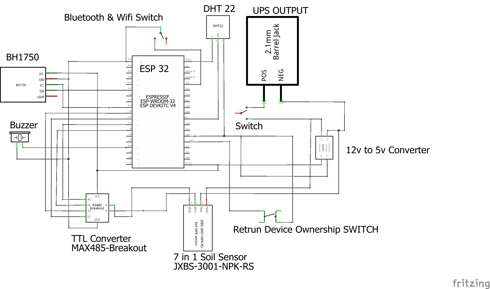

# SiliGuide IoT - ESP32 

Isang modular, secure, at high-performance firmware para sa **ESP32** na sumusuporta sa multi-sensor soil at environmental monitoring gamit ang **Bluetooth Classic (SPP)** at **Wi-Fi (SoftAP & LAN Station Mode)**.

---

## 📌 Talaan ng Nilalaman (Table of Contents)
- [Pangkalahatang Ideya](#-pangkalahatang-ideya-overview)
- [Struktura ng mga Files (Modular Architecture)](#-struktura-ng-mga-files-modular-architecture)
- [Capstone Schematic Diagram](#-capstone-schematic-diagram)
- [Pinout at Hardware Connections](#-pinout-at-hardware-connections)
- [Dalawang Operating Modes (Hardware Switch - Pin 33)](#-dalawang-operating-modes-hardware-switch---pin-33)
- [Mga Sensor at Data Timing](#-mga-sensor-at-data-timing)
- [Bluetooth at HTTP API Endpoints](#-bluetooth-at-http-api-endpoints)
- [Seguridad at Encryption (AES-256 GCM)](#-seguridad-at-encryption-aes-256-gcm)
- [Mga Kinakailangang Libraries](#-mga-kinakailangang-libraries)
- [Paano I-upload gamit ang Arduino IDE](#-paano-i-upload-gamit-ang-arduino-ide)

---

## 🚀 Pangkalahatang Ideya (Overview)

Ang sistemang ito ay idinisenyo para sa agricultural monitoring ng sili/pananim. Sinusukat nito ang sumusunod nang **real-time bawat 1 segundo**:
1. **Soil Parameters (7-in-1 Modbus RS485):** Moisture, Soil Temperature, Electrical Conductivity (EC), pH, Nitrogen (N), Phosphorus (P), Potassium (K).
2. **Environmental Conditions:** Air Temperature & Humidity ([DHT22](file:///c:/Users/Administrator/Desktop/Capstone%20Patch%20ESP%2032%20code/esp32_OCT_24%20patch/dht22_sensor.h)), Ambient Light Intensity in Lux ([BH1750](file:///c:/Users/Administrator/Desktop/Capstone%20Patch%20ESP%2032%20code/esp32_OCT_24%20patch/bh1750_sensor.h)).
3. **Data Security:** AES-256 GCM encryption sa payload kapag naka-claim ang device.

---

## 📁 Struktura ng mga Files (Modular Architecture)

Naka-organisa ang code gamit ang modular `.h` (header) files upang malinis, mabilis baguhin, at madaling i-maintain:

| File | Deskripsyon |
| :--- | :--- |
| [**`esp32_OCT_24 patch.ino`**](file:///c:/Users/Administrator/Desktop/Capstone%20Patch%20ESP%2032%20code/esp32_OCT_24%20patch/esp32_OCT_24%20patch.ino) | Main sketch file. Nagpapatakbo ng setup at loop lifecycle sa pamamagitan ng pag-callout sa bawat module. |
| [**`config.h`**](file:///c:/Users/Administrator/Desktop/Capstone%20Patch%20ESP%2032%20code/esp32_OCT_24%20patch/config.h) | Central configuration: Pin definitions, radio TX power levels, timeouts, at 1-second update interval. |
| [**`dht22_sensor.h`**](file:///c:/Users/Administrator/Desktop/Capstone%20Patch%20ESP%2032%20code/esp32_OCT_24%20patch/dht22_sensor.h) | Initialization at non-blocking reading function para sa DHT22 air sensor. |
| [**`bh1750_sensor.h`**](file:///c:/Users/Administrator/Desktop/Capstone%20Patch%20ESP%2032%20code/esp32_OCT_24%20patch/bh1750_sensor.h) | I2C detection at lux reading function para sa BH1750 ambient light sensor. |
| [**`soil_sensor.h`**](file:///c:/Users/Administrator/Desktop/Capstone%20Patch%20ESP%2032%20code/esp32_OCT_24%20patch/soil_sensor.h) | RS485 ModbusMaster initialization, pre/post callbacks, at parsing para sa 7-in-1 soil probe. |
| [**`system_utils.h`**](file:///c:/Users/Administrator/Desktop/Capstone%20Patch%20ESP%2032%20code/esp32_OCT_24%20patch/system_utils.h) | AES-256 GCM crypto engine, NVS Preferences storage, buzzer tones, at JSON string builders. |
| [**`ap_mode.h`**](file:///c:/Users/Administrator/Desktop/Capstone%20Patch%20ESP%2032%20code/esp32_OCT_24%20patch/ap_mode.h) | SoftAP creation, HTTP WebServer endpoints (`/info`, `/data`, atbp.), mDNS, at background Wi-Fi reconnect engine. |
| [**`bluetooth_mode.h`**](file:///c:/Users/Administrator/Desktop/Capstone%20Patch%20ESP%2032%20code/esp32_OCT_24%20patch/bluetooth_mode.h) | Bluetooth Classic SPP stack, command parser, connection callbacks, at visibility watchdog. |

---

## 📐 Capstone Schematic Diagram

Nasa ibaba ang opisyal na Fritzing circuit schematic diagram para sa buong Capstone project setup:

### ⚡ Buod ng Koneksyon sa Schematic:
1. **Power Supply & Distribution (UPS 12V Output & LM2596 Step-Down):**
   - **UPS Output (2.1mm Barrel Jack, 12V):** Dumadaan sa **Main Power Switch**.
   - **LM2596 DC-DC Buck Converter (12V to 5V):**
     - `+Vi` / `-Vi`: Konektado sa 12V output pagkatapos ng Switch at common GND.
     - `+Vo` (Naka-regulate sa 5V): Nagbibigay ng 5V power sa `EXT_5V` pin ng ESP32 at `VCC` ng MAX485 TTL Breakout.
     - `-Vo`: Naka-tie sa common System Ground (GND).
   - **7-in-1 Soil Sensor (JXBS-3001-NPK-RS):**
     - `PWR+`: Direktang nakakabit sa 12V rail mula sa Switch.
     - `PWR-`: Nakakabit sa common Ground (GND).
2. **ESP32 Node & Sensor Interfacing:**
   - **DHT22:** Pinapagana ng 3.3V (`VDD33`), GND, at ang Data OUT ay nakakabit sa **GPIO 27**.
   - **BH1750:** Pinapagana ng 3.3V, GND, `ADDR` sa GND, `SDA` sa **GPIO 21**, at `SCL` sa **GPIO 18**.
   - **MAX485 TTL Breakout Module:** Pinapagana ng 5V (`EXT_5V`), GND, `RO` sa **GPIO 16 (RX2)**, `DI` sa **GPIO 17 (TX2)**, `RE` sa **GPIO 4**, at `DE` sa **GPIO 5**.
   - **RS485 Differential Bus:** Ang `A` at `B` pins ng MAX485 module ay nakakonekta sa `485A` at `485B` wires ng JXBS-3001 soil sensor.
3. **Controls & Indicators:**
   - **Bluetooth & WiFi Mode Switch:** Naka-wire sa **GPIO 33** papuntang Ground gamit ang internal pull-up.
   - **Return Device Ownership SWITCH (Reset Button):** Naka-wire sa **GPIO 13** papuntang Ground.
   - **Buzzer:** Nakakabit sa pagitan ng **GPIO 15** at Ground.

---

## 🔌 Pinout at Hardware Connections

| Module / Pungtasyon | ESP32 GPIO Pin | Uri / Protocol | Karagdagang Detalye |
| :--- | :--- | :--- | :--- |
| **Mode Switch** | **GPIO 33** | Digital Input | Gamit ang internal `INPUT_PULLUP`. Nakakabit papuntang Ground (GND). |
| **Reset Button** | **GPIO 13** | Digital Input | Internal `INPUT_PULLUP`. Pindutin ng 5 segundo para sa NVS wipe / recovery reset. |
| **Buzzer** | **GPIO 15** | PWM / Digital Output | 2.7 kHz resonant tone pagkatapos ng recovery reset. |
| **DHT22** | **GPIO 27** | Single-Bus Digital | Data pin para sa temperatura at moisture ng hangin. |
| **BH1750 (SDA)** | **GPIO 21** | I2C Data | 3.3V I2C bus (Address: `0x23`). |
| **BH1750 (SCL)** | **GPIO 18** | I2C Clock | 3.3V I2C bus. |
| **MAX485 / RS485 RX** | **GPIO 16** | HardwareSerial 2 RX | Konektado sa RO pin ng MAX485 module. |
| **MAX485 / RS485 TX** | **GPIO 17** | HardwareSerial 2 TX | Konektado sa DI pin ng MAX485 module. |
| **MAX485 RE** | **GPIO 4** | Digital Output | Receiver Enable (Active LOW). |
| **MAX485 DE** | **GPIO 5** | Digital Output | Driver Enable (Active HIGH). |

---

## 🎛 Dalawang Operating Modes (Hardware Switch - Pin 33)

Ang firmware ay sumusuporta sa **hot-switching** habang tumatakbo ang ESP32 nang hindi kailangang i-reboot:

1. **Bluetooth + LAN Station Mode (Switch ON - Pin 33 LOW):**
   - Naka-**ON** ang Bluetooth Classic SPP (`SiliGuide_XXXXXX`).
   - Naka-**OFF** ang SoftAP upang 100% antenna time ang maibigay sa Bluetooth at Router connection.
   - Awtomatikong kumokonekta sa nakatagong Wi-Fi router (kung may naka-save na credentials).
2. **AP Mode Only (Switch OFF - Pin 33 HIGH):**
   - Naka-**OFF** ang Bluetooth stack.
   - Nagsisimula ang sariling Wi-Fi Access Point ng ESP32 (`SiliGuide_IoT_XXXXXX`).
   - Default SoftAP Password: `Sili_D8CBB0mQnVBs52`
   - IP Address: `192.168.4.1`

---

## ⏱ Mga Sensor at Data Timing

Upang maalis ang dating excess delays:
- **`SENSOR_INTERVAL` = 1000 ms (1 segundo):** Bawat 1 segundo, sabay-sabay na binabasa ang BH1750, Modbus Soil Sensor, at DHT22.
- **80ms Non-Blocking Modbus Timeout:** Sa pamamagitan ng `RS485Serial.setTimeout(80)`, hindi mag-ha-hang o babagal ang `loop()` kahit bunutin o hindi sumagot ang soil sensor.
- **Inalis ang 15-Second Fail Delay:** Hindi na nagpapatong-patong ang delay sakaling magka-read error sa Modbus.
- **Inalis ang Bluetooth Modbus Lockout:** Maaari nang basahin ang soil sensor kahit may aktibong koneksyon ang mobile app sa Bluetooth.

---

## 📡 Bluetooth at HTTP API Endpoints

### 🌐 HTTP Web Server (Port 80)
- `GET /info` - Nagbabalik ng device metadata, MAC address, token, at network mode.
- `GET /data` - Nagbabalik ng pinakabagong JSON sensor data (naka-encrypt gamit ang AES-256 GCM kung claimed).
- `GET /wifi-status` - Kasalukuyang Wi-Fi connection status at IP address.
- `POST /claim` - I-lock at i-claim ang device gamit ang pairing token.
- `POST /configure` - Mag-save ng bagong Wi-Fi SSID at password (encrypted payload).
- `POST /reset` - Mag-trigger ng software reset.
- `POST /connect-wifi` & `POST /disconnect-wifi` - Manu-manong kontrol sa router connection.

### 📶 Bluetooth Serial Commands (SPP)
Magpadala ng string na may newline (`\n`):
- `PING` $\rightarrow$ Sumasagot ng `PONG`
- `GET_INFO` $\rightarrow$ Device info JSON
- `GET_DATA` $\rightarrow$ Sensor reading JSON (o encrypted string kung claimed)
- `GET_WIFI_STATUS` $\rightarrow$ Wi-Fi connection status
- `CLAIM:<token>` $\rightarrow$ I-claim ang device
- `CONFIGURE:<encrypted_json>` $\rightarrow$ I-configure ang router Wi-Fi
- `RESET:<encrypted_json>` $\rightarrow$ Factory wipe at reboot
- `CONNECT_WIFI` / `DISCONNECT_WIFI` $\rightarrow$ Kontrol sa koneksyon sa Wi-Fi

---

## 🔐 Seguridad at Encryption (AES-256 GCM)

- **Pairing Token:** Awtomatikong binubuo sa unang pag-boot gamit ang `esp_random()` at nakatago sa non-volatile flash (`Preferences` namespace: `pair`).
- **Claim Lock:** Kapag matagumpay na na-claim, lahat ng sensor payload at configuration command ay ine-encrypt gamit ang **AES-256 GCM** kasama ang 12-byte random IV at 16-byte authentication tag na naka-Base64 format.

---

## 📦 Mga Kinakailangang Libraries

Bago i-compile sa Arduino IDE, siguraduhing naka-install ang mga sumusunod sa **Library Manager** (`Ctrl + Shift + I`):
1. **DHT sensor library** (by Adafruit) + **Adafruit Unified Sensor**
2. **BH1750** (by Christopher Laws)
3. **ModbusMaster** (by Doc Walker / 4-20ma)

*(Kasama na sa ESP32 Board Package ang `WiFi`, `WebServer`, `BluetoothSerial`, `Preferences`, `ESPmDNS`, at `mbedtls`.)*

---

## 💻 Paano I-upload gamit ang Arduino IDE

1. Buksan ang folder sa Arduino IDE sa pamamagitan ng pag-click sa [**`esp32_OCT_24 patch.ino`**](file:///c:/Users/Administrator/Desktop/Capstone%20Patch%20ESP%2032%20code/esp32_OCT_24%20patch/esp32_OCT_24%20patch.ino).
2. Piliin ang Board: **Tools > Board > esp32 > ESP32 Dev Module** (o katumbas na ESP32 board).
3. Piliin ang tamang COM Port sa ilalim ng **Tools > Port**.
4. I-set ang Upload Speed: **921600** o **115200**.
5. I-click ang **Upload** (`Ctrl + U`).
6. Buksan ang **Serial Monitor** sa baud rate na **115200** upang makita ang boot logs at real-time readings.
